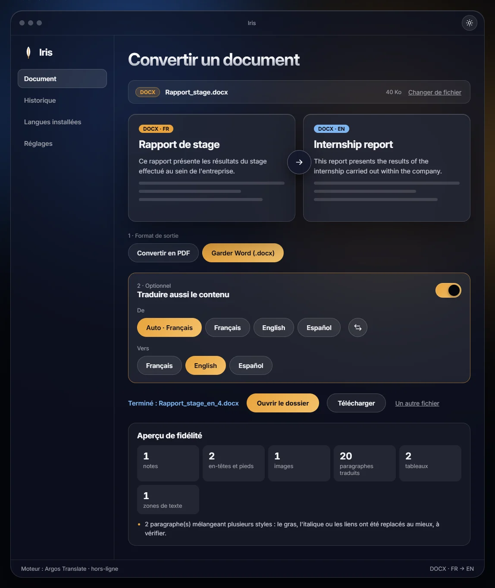
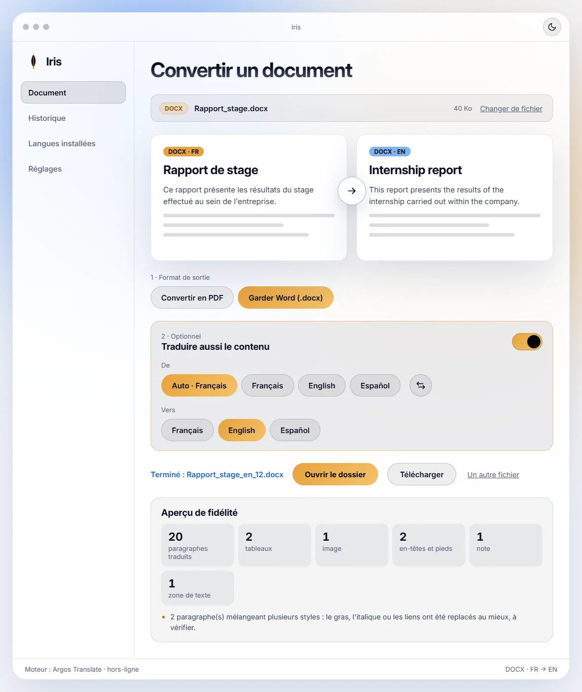

# Iris

Convertit des documents **Word** et **PDF** et, si tu le souhaites, les **traduit** en français,
anglais ou espagnol, en changeant la mise en page le moins possible.

Gratuit, open source, sans compte et sans cloud : tes fichiers ne quittent jamais ton ordinateur.
Internet ne sert qu'une fois, pour installer le projet et télécharger les modèles de langue.

| Thème sombre | Thème clair |
| --- | --- |
|  |  |

## Installation
### Windows : en un double-clic
1. [Télécharge le ZIP](https://github.com/AxelahtMtg03/iris-docs/archive/refs/heads/main.zip).
2. Clic droit sur le fichier téléchargé, puis **Extraire tout**.
3. Dans le dossier obtenu, double-clique sur **Installer** (`Installer.bat`). Si Windows affiche
   « Windows a protégé votre ordinateur », clique sur **Informations complémentaires** puis
   **Exécuter quand même**.

Tout s'installe : Python, les composants, LibreOffice, Tesseract, les modèles de traduction et le
raccourci. Compte 10 à 20 minutes et environ 3 Go ; Windows peut demander ton autorisation.
Iris s'ouvre à la fin et le dossier téléchargé peut être supprimé. Pour mettre à jour,
recommence avec le nouveau ZIP.

### Installation manuelle (macOS, Linux, développement)
Il faut **Python 3.10 ou plus récent** et environ 2 Go d'espace disque.

```bash
git clone https://github.com/AxelahtMtg03/iris-docs
cd iris-docs
python -m venv .venv
```

Active l'environnement : `.venv\Scripts\activate` (Windows) ou `source .venv/bin/activate`
(macOS, Linux). Sous Linux, installe d'abord la version « processeur » de PyTorch, bien plus
légère :

```bash
pip install torch --index-url https://download.pytorch.org/whl/cpu
```

Puis :

```bash
pip install -r requirements.txt
python run.py
```

Au premier lancement, ouvre **Langues installées** et clique sur **Installer** (environ 600 Mo
pour les deux paires). C'est la seule fois où Iris utilise internet.

### L'installer comme une application

Pour ouvrir Iris d'un double-clic, sans terminal :

```bash
python -m iris install
```

Un raccourci « Iris » apparaît dans le menu Démarrer et sur le bureau (Windows), ou dans le menu
des applications (Linux). Il s'appuie sur ce dossier : ne le déplace pas, ou relance la commande
après l'avoir déplacé. Sous Windows, la fenêtre a sa propre barre de titre et son icône dans la
barre des tâches, où tu peux l'épingler. `python -m iris uninstall` retire les raccourcis. Sur macOS, utilise
`python run.py`.

### Deux logiciels à ajouter

| Logiciel | Sert à | Windows | macOS | Linux (Debian, Ubuntu) |
| --- | --- | --- | --- | --- |
| LibreOffice | créer un PDF depuis un Word ou un scan | `winget install TheDocumentFoundation.LibreOffice` | `brew install --cask libreoffice` | `sudo apt install libreoffice-writer` |
| Tesseract | lire les PDF scannés | `winget install UB-Mannheim.TesseractOCR` | `brew install tesseract tesseract-lang` | `sudo apt install tesseract-ocr tesseract-ocr-fra tesseract-ocr-spa` |

Sous Windows, l'installeur de Tesseract n'ajoute que l'anglais par défaut. Coche le français et
l'espagnol pendant l'installation, ou place `eng.traineddata`, `fra.traineddata` et
`spa.traineddata` (dépôt [tessdata_fast](https://github.com/tesseract-ocr/tessdata_fast)) dans
`%LOCALAPPDATA%\Iris\tessdata`.

S'il manque un de ces logiciels, Iris le détecte et explique quoi installer.

## Utilisation

`python run.py` ouvre Iris dans sa propre fenêtre, ou dans le navigateur si aucune fenêtre
n'est disponible (`python run.py --browser` pour le forcer).

1. **Dépose** un fichier `.docx` ou `.pdf`.
2. **Choisis** le format de sortie. La traduction est une option à activer.
3. Clique sur **Convertir**, **Traduire** ou **Convertir et traduire**.

Le résultat s'appelle `Nom.ext`, ou `Nom_en.ext` après traduction. Rien n'est écrasé : un
fichier existant donne `Nom_1.ext`, `Nom_2.ext`…

**Où est enregistré le résultat ?** Choisi en cliquant sur la zone, à côté du fichier source. Un fichier
*glissé* dans la fenêtre n'indique pas son dossier d'origine : le résultat va alors dans
`Téléchargements/Iris`. Tu peux imposer un dossier dans les réglages.

### En ligne de commande

```bash
python -m iris convert rapport.docx --to pdf
python -m iris translate rapport.docx --from fr --to en
python -m iris translate scan.pdf --to es --format docx --out resultats/
python -m iris models list
python -m iris models install
```

## Ce que fait Iris, et ses limites

- **Word vers Word traduit** : seul le texte change. Styles, polices, marges, tableaux (même
  imbriqués), images, listes, numérotation, en-têtes, pieds de page, notes et zones de texte
  restent en place. Les champs (numéros de page, renvois) ne sont pas touchés.
- **Texte plus long** : une traduction vers le français ou l'espagnol allonge souvent le texte.
  Des sauts de ligne ou de page peuvent bouger ; la taille des polices n'est jamais réduite.
- **Gras, italique, liens** : dans une phrase à plusieurs styles, Iris replace chaque style sur
  les mots correspondants. Ce placement est approximatif quand l'ordre des mots change : le
  rapport de fidélité le signale.
- **Qualité de traduction** : celle des modèles libres Argos. Relis tout document important.
  Français ↔ espagnol passe par l'anglais et perd un peu en qualité. Les noms propres peuvent
  être traduits à tort.
- **Non traduits** : adresses web, courriels, code, nombres, champs de fusion, commentaires,
  texte contenu dans les images, graphiques et SmartArt.
- **PDF traduit en PDF** (le mieux) : chaque paragraphe est réécrit à sa place. Images, schémas,
  filets, numéros et pages ne bougent pas. La police est remplacée par une police proche, et un
  passage plus long que l'original peut être légèrement réduit (le rapport le signale). Les
  formules mathématiques et le texte contenu dans les images ne sont pas traduits.
- **PDF vers Word** : ce format n'est pas fait pour être modifié. La mise en page est
  *reconstruite* et peut différer, surtout avec des colonnes ou des tableaux complexes.
- **PDF scannés** : seul le texte est récupéré ; images, tableaux et mise en forme sont perdus.
- **Fichiers** : `.docx` et `.pdf` uniquement, sans mot de passe, 100 Mo par défaut.

## Confidentialité et sécurité

Le serveur n'écoute que sur `127.0.0.1`, exige un jeton tiré au hasard à chaque lancement,
vérifie le type réel des fichiers et supprime ses fichiers temporaires. Aucun appel réseau n'a
lieu en dehors du téléchargement des modèles, que tu déclenches toi-même.

Historique, réglages et journal (`iris.log`) sont enregistrés dans `%LOCALAPPDATA%\Iris`,
`~/Library/Application Support/Iris` ou `~/.local/share/iris`.

## Questions fréquentes

**La conversion en PDF est grisée.** LibreOffice n'a pas été trouvé. Installe-le puis relance
Iris. Tu peux indiquer un emplacement particulier avec la variable `IRIS_SOFFICE`
(`IRIS_TESSERACT` pour Tesseract).

**La fenêtre ne s'ouvre pas sous Linux.** Iris bascule sur le navigateur. Pour une vraie
fenêtre, installe un moteur d'affichage pour [pywebview](https://pywebview.flowrl.com/).

**« Session expirée ».** Chaque lancement a son propre jeton : utilise la page ouverte par le
dernier `python run.py`.

**Puis-je travailler sans réseau ?** Oui, dès que les modèles sont installés.

## Site vitrine

Le dossier `site/` est une page statique, sans étape de construction. Mets l'adresse de ton dépôt
dans [`site/js/config.js`](site/js/config.js), puis :

```bash
python -m http.server --directory site 8000
```

Pour le publier sur GitHub Pages, choisis *Settings → Pages → Source : GitHub Actions* et lance
le workflow **Site**.

## Développement

```bash
pip install -r requirements-dev.txt
python -m pytest
ruff check .
black --check .
```

Les tests qui ont besoin de LibreOffice, de Tesseract ou des modèles sont ignorés quand ceux-ci
sont absents. `python tests/make_samples.py` recrée les documents d'exemple.

```
iris/        moteur, serveur local et interface (iris/web)
site/        site vitrine
tests/       tests et documents d'exemple
design-reference/   maquettes de référence
```

## Licence

Iris est distribué sous licence [MIT](LICENSE).

Ses dépendances gardent leur propre licence, notamment
[PyMuPDF](https://github.com/pymupdf/PyMuPDF) (AGPL-3.0, utilisé par pdf2docx : à prendre en
compte si tu redistribues une application qui l'embarque),
[Argos Translate](https://github.com/argosopentech/argos-translate) (MIT),
[LibreOffice](https://www.libreoffice.org/) (MPL-2.0),
[Tesseract](https://github.com/tesseract-ocr/tesseract) (Apache-2.0) et la police
[Inter](iris/web/fonts/OFL.txt) (SIL Open Font License).
